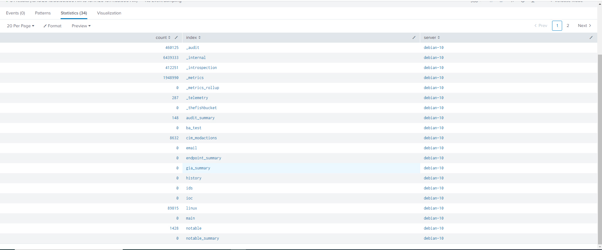
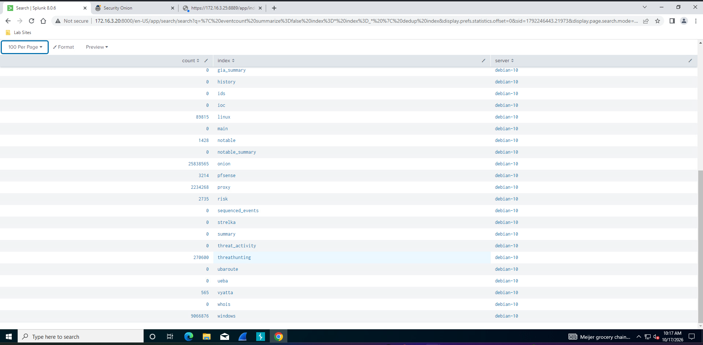
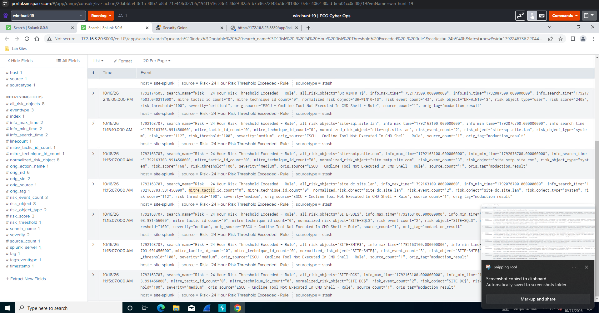
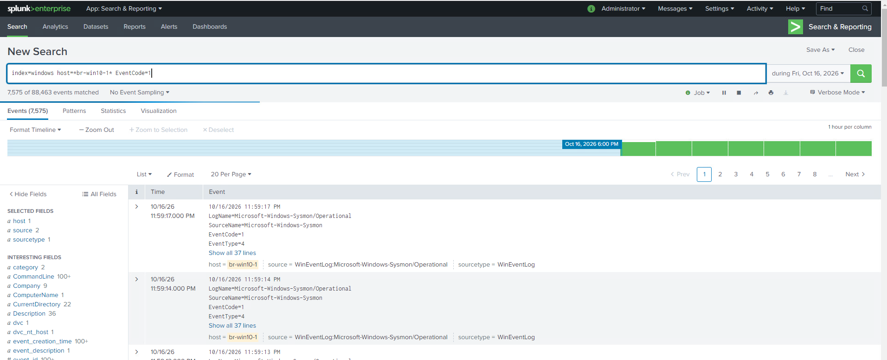
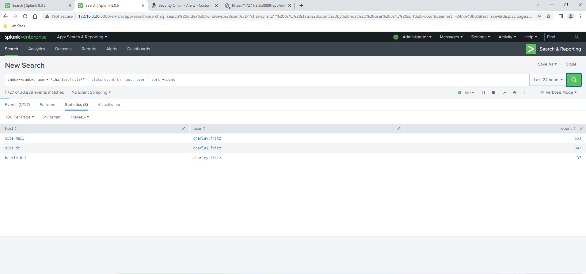
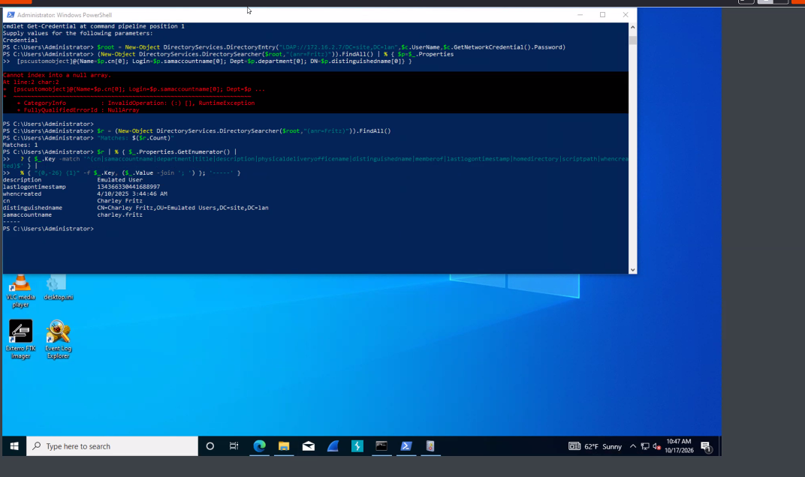
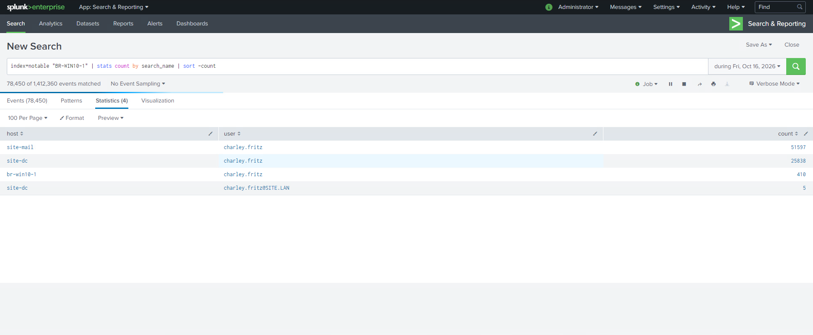
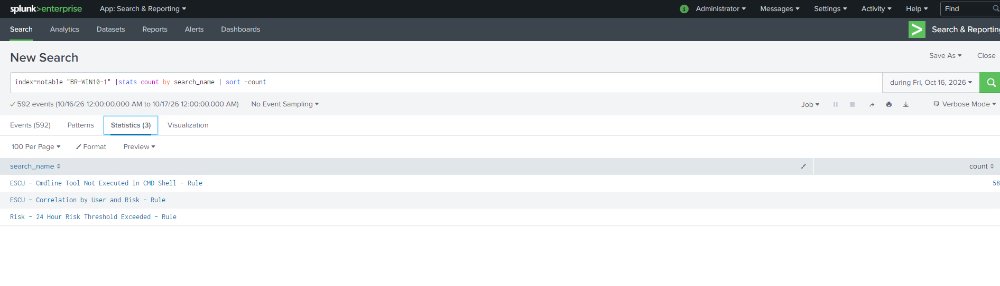

# 1. Find the user, workstation and useful sources

[Gallery](README.md) · [Noah / Start here](../README.md) · [Findings](../FINDINGS.md)

## EV-001 — Available log sources, page 1

**Look for:** The first page of the Splunk index survey inventories available data sources.

**Do not conclude:** Log volume and source availability do not establish compromise.

[Open original image](images/EV-001_splunk-index-survey-pg1.png) · [Verify hash](manifest.csv)

---

## EV-002 — Available log sources, page 2

**Look for:** The second survey page identifies Windows, proxy and network-log indexes used for later pivots.

**Do not conclude:** An index count is not the number of attacker actions.

[Open original image](images/EV-002_splunk-index-survey-pg2.png) · [Verify hash](manifest.csv)

---

## EV-004 — Risk alerts prioritize a workstation

**Look for:** The alert view includes BR-WIN10-1 with a high risk score and other alerted hosts.

**Do not conclude:** Risk ranking is a triage lead, not proof that every listed host is compromised.

[Open original image](images/EV-004_splunk-risk-notables-24h.png) · [Verify hash](manifest.csv)

---

## EV-005 — Workstation process-event volume

**Look for:** The query returns 7,575 matching process-creation events for the selected workstation/date.

**Do not conclude:** These are not 7,575 malware launches or proof of continued attack through the final displayed hour.

[Open original image](images/EV-005_brwin10-1_proc-create-oct16-volume.png) · [Verify hash](manifest.csv)

---

## EV-008 — Account activity across hosts

**Look for:** The selected search displays charley.fritz activity on multiple hosts, including BR-WIN10-1.

**Do not conclude:** Account activity alone neither identifies the sole workstation nor proves lateral movement; user report and additional context matter.

[Open original image](images/EV-008_charleyfritz-hosts.png) · [Verify hash](manifest.csv)

---

## EV-009 — Reporting-user account lookup

**Look for:** The directory lookup identifies Charley Fritz / charley.fritz with the Emulated User description.

**Do not conclude:** This does not identify an attacker-created account or prove credential theft. The credential prompt shown does not expose the password.

[Open original image](images/EV-009_ad-lookup-charleyfritz.png) · [Verify hash](manifest.csv)

---

## EV-010 — An activity-count lead, not a finding

**Look for:** A table shows account-related event counts; the search bar contains a different newly typed query.

**Do not conclude:** The displayed table is not the result of the unexecuted query in the bar, and a count spike is not proof of credential abuse.

[Open original image](images/EV-010_charleyfritz-activity-spike-oct16.png) · [Verify hash](manifest.csv)

---

## EV-011 — Alert-rule breakdown

**Look for:** The notable-event table highlights a non-CMD-parent command-line detection among the rules.

**Do not conclude:** An automated detection is a reason to inspect process evidence, not a completed maliciousness decision.

[Open original image](images/EV-011_brwin10-1_notable-breakdown.png) · [Verify hash](manifest.csv)

---

[Next chapter](02-local-sequence.md)
