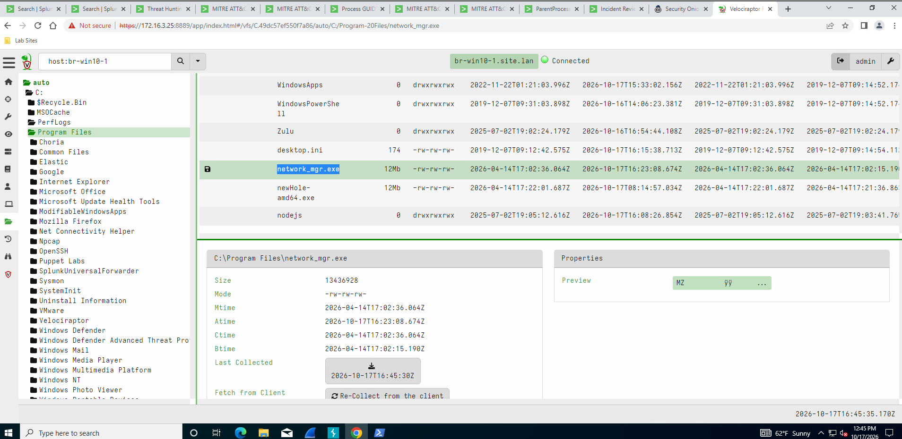
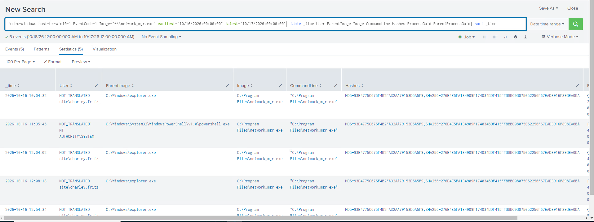
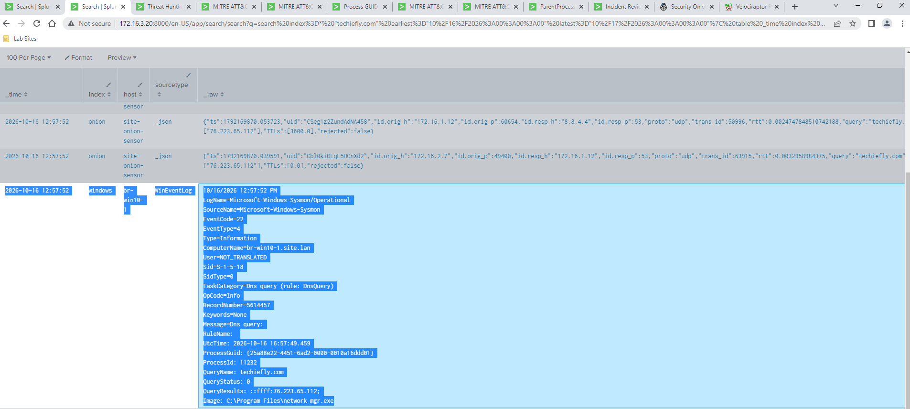
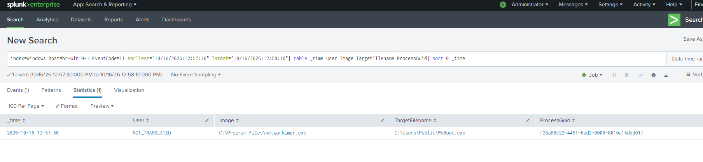
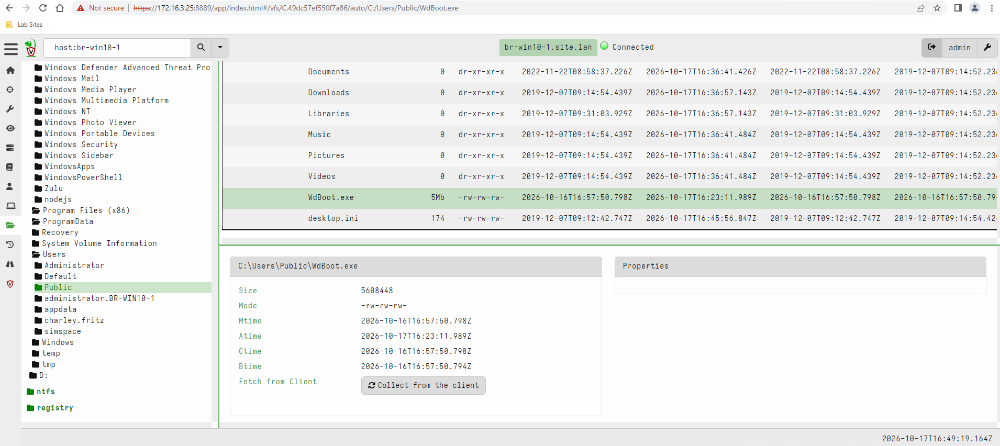
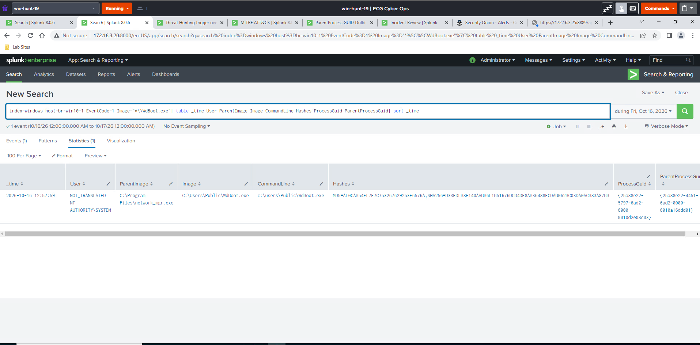

# 2. Link DNS, file placement and execution

[Gallery](README.md) · [Noah / Start here](../README.md) · [Findings](../FINDINGS.md)

## EV-026 — Pre-existing network_mgr file metadata

**Look for:** VFS metadata records network_mgr creation in April 2026, before the October event sequence.

**Do not conclude:** Metadata does not establish original delivery, trustworthiness or an attacker foothold.

[Open original image](images/EV-026_brwin10-1_network-mgr-file-metadata.png) · [Verify hash](manifest.csv)

---

## EV-019 — Earlier network_mgr executions

**Look for:** The timeline shows network_mgr executions with Explorer and PowerShell parents earlier that day.

**Do not conclude:** Explorer parentage does not prove a manual malicious-file double-click; the range provisioning context matters.

[Open original image](images/EV-019_brwin10-1_network-mgr-execution-timeline.png) · [Verify hash](manifest.csv)

---

## EV-032 — Screenshot of the DNS event

**Look for:** The screenshot corroborates the Sysmon DNS process, GUID, query and answer alongside DNS records.

**Do not conclude:** Use original UtcTime rather than rounded/ingested display time; the source-domain claim remains a hypothesis.

[Open original image](images/EV-032_techiefly-sysmon-dns-screenshot.png) · [Verify hash](manifest.csv)

---

## EV-028 — The process that wrote WdBoot

**Look for:** Sysmon Event 11 names network_mgr as writer of the Public-directory WdBoot file at 12:57:50; its GUID links to the launch/DNS sequence.

**Do not conclude:** A file writer is not necessarily the original intrusion vector or proof of a particular source download.

[Open original image](images/EV-028_brwin10-1_wdboot-file-writer.png) · [Verify hash](manifest.csv)

---

## EV-027 — WdBoot file metadata

**Look for:** The VFS view records a 5,608,448-byte file and birth time 16:57:50.794 UTC.

**Do not conclude:** A file timestamp is not a network-transfer record or independent proof that timestamps were not manipulated.

[Open original image](images/EV-027_brwin10-1_wdboot-file-metadata.png) · [Verify hash](manifest.csv)

---

## EV-018 — WdBoot execution as SYSTEM

**Look for:** The process-creation table shows network_mgr launching C:\Users\Public\WdBoot.exe as SYSTEM at 12:57:59, with process/parent GUIDs.

**Do not conclude:** It does not establish how the original foothold was obtained. Recheck any executable hash transcription against this source before using it as an exact IOC.

[Open original image](images/EV-018_brwin10-1_wdboot-execution-hash.png) · [Verify hash](manifest.csv)

---

[Previous chapter](01-orientation.md) · [Next chapter](03-execution-and-discovery.md)
