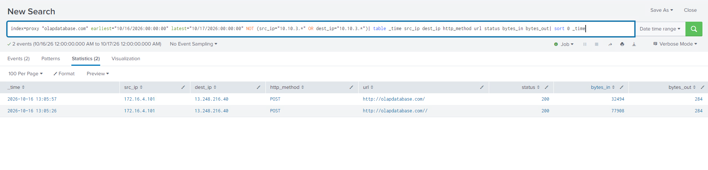
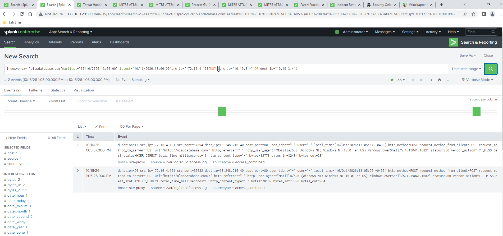
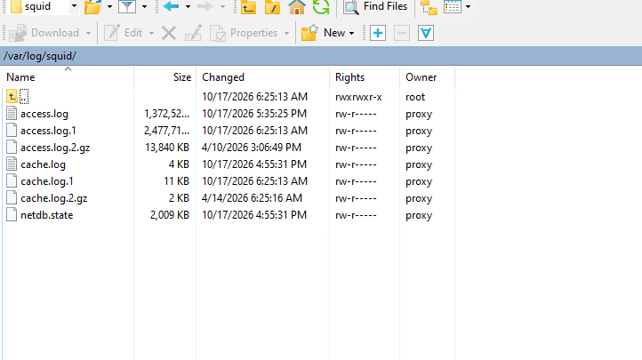
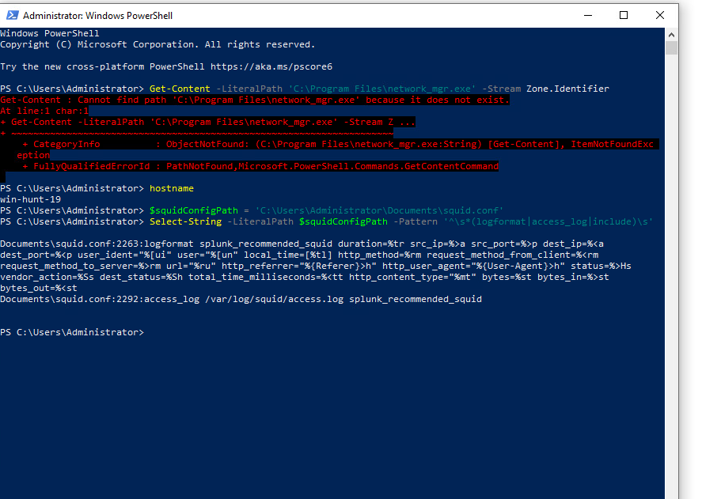

# 4. Corroborate uploads and interpret the proxy

[Gallery](README.md) · [Noah / Start here](../README.md) · [Findings](../FINDINGS.md)

## EV-035 — Two POSTs, two responses

**Look for:** The table shows workstation POSTs to olapdatabase[.]com at 13:05:26 and 13:05:57, both HTTP 200, with different slash forms.

**Do not conclude:** Exact uploaded contents and storage on the remote server are unknown. Request/reply counter meanings are explained by EV-049.

[Open original image](images/EV-035_brwin10-1_olapdatabase-posts.png) · [Verify hash](manifest.csv)

---

## EV-042 — Full proxy POST event view

**Look for:** Original field-rich records identify site-proxy, /var/log/squid/access.log, PowerShell user-agent, POST methods, HTTP 200 and explicit -0400 timestamps.

**Do not conclude:** Metadata does not contain an uploaded filename or request body; user-agent is not unique process attribution.

[Open original image](images/EV-042_proxy-posts-full-log-view.png) · [Verify hash](manifest.csv)

---

## EV-047 — Proxy log directory through SFTP

**Look for:** The user-operated remote pane lists current/rotated access and cache logs in /var/log/squid/.

**Do not conclude:** A directory listing does not establish contents, exact truncated file sizes, event coverage or independently verified SSH identity.

[Open original image](images/EV-047_proxy-squid-log-directory.png) · [Verify hash](manifest.csv)

---

## EV-049 — Logging format and byte directions

**Look for:** A read-only query of the full local configuration shows the active format and access_log definition: bytes=%st, bytes_in=%>st, bytes_out=%<st.

**Do not conclude:** Request totals include HTTP overhead, not exact file sizes. Historical loaded configuration was not separately proved. Old analyst path errors visible above are not victim deletion evidence.

[Open original image](images/EV-049_squid-active-logformat-query.png) · [Verify hash](manifest.csv)

---

[Previous chapter](03-execution-and-discovery.md) · [Next chapter](05-recovery-and-tool-limits.md)
