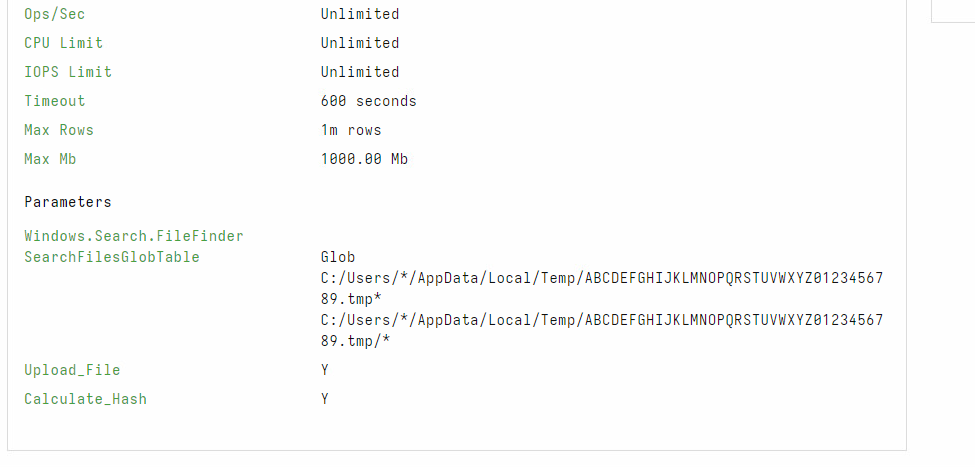
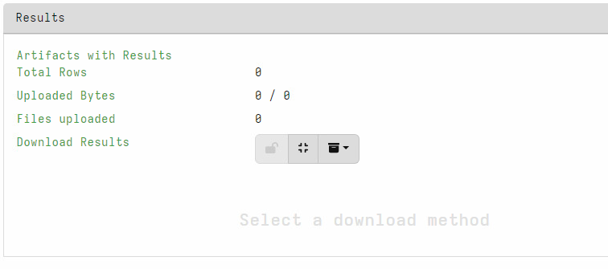
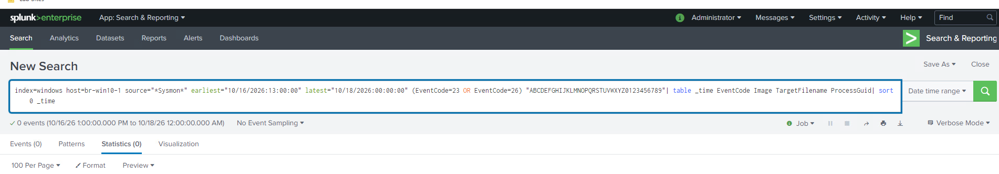
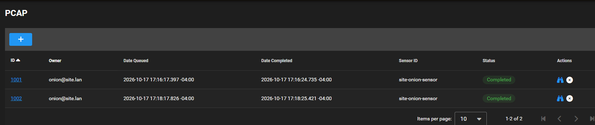
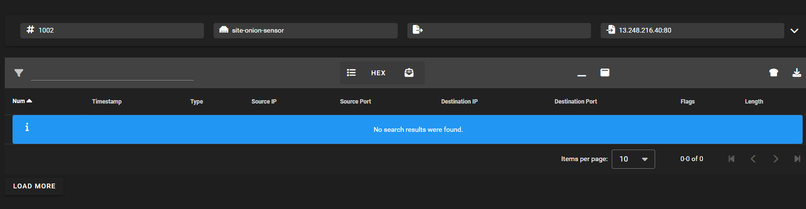
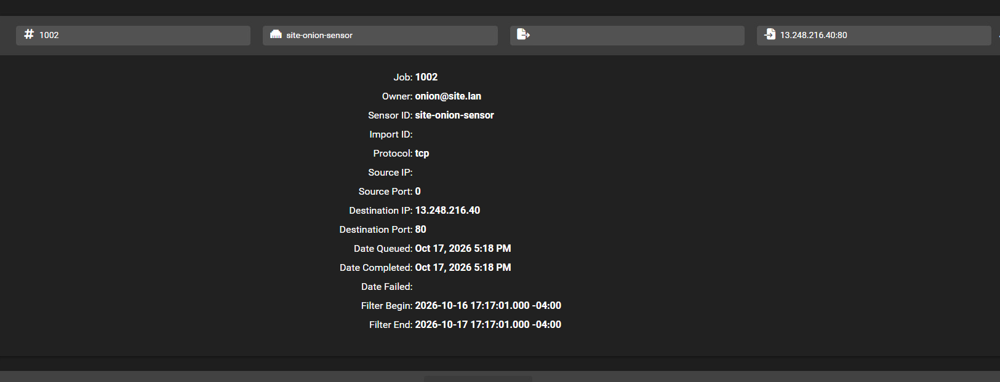
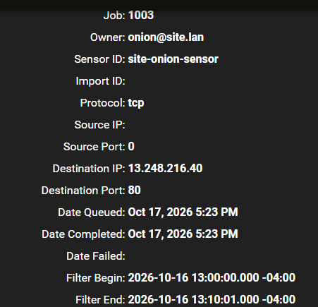

# 5. Understand recovery limits and tool problems

[Gallery](README.md) · [Noah / Start here](../README.md) · [Findings](../FINDINGS.md)

## EV-038 — Analyst FileFinder search parameters

**Look for:** The expanded all-profile glob patterns target the distinctive staging path, archive and direct children with hashing/collection enabled.

**Do not conclude:** This is analyst collection code, not malware source; configuration alone is not a recovered artifact.

[Open original image](images/EV-038_filefinder-expanded-parameters.png) · [Verify hash](manifest.csv)

---

## EV-039 — FileFinder returned no artifacts

**Look for:** The view shows zero rows, zero uploads and zero files.

**Do not conclude:** The cropped view lacks the flow ID/completion state; absence of a recovered file is not proof of deletion or failed creation.

[Open original image](images/EV-039_filefinder-zero-results.png) · [Verify hash](manifest.csv)

---

## EV-040 — No matching deletion events

**Look for:** The targeted staging-name Sysmon deletion-event search shows zero matches.

**Do not conclude:** This does not establish comprehensive deletion coverage, non-deletion, or whether the files ever existed.

[Open original image](images/EV-040_staging-deletion-search-zero.png) · [Verify hash](manifest.csv)

---

## EV-043 — Completed PCAP jobs

**Look for:** Jobs 1001 and 1002 display Completed on site-onion-sensor.

**Do not conclude:** Completion does not mean packets were found. Queue/completion dates are not the traffic-filter date range.

[Open original image](images/EV-043_pcap-completed-jobs.png) · [Verify hash](manifest.csv)

---

## EV-044 — Job 1002 returned zero packets

**Look for:** The packet view shows no rows for the requested external destination.

**Do not conclude:** Its filter was later shown to exclude the uploads. This cannot test packet availability at the incident time.

[Open original image](images/EV-044_pcap-job-1002-zero-packets.png) · [Verify hash](manifest.csv)

---

## EV-045 — The incorrect time filter was identified

**Look for:** Expanded job 1002 bounds run from Oct. 16 17:17 to Oct. 17 17:17 at UTC-04:00.

**Do not conclude:** That is a 24-hour interval beginning after the 13:05 uploads, not both complete calendar days.

[Open original image](images/EV-045_pcap-job-1002-filter-details.png) · [Verify hash](manifest.csv)

---

## EV-046 — Corrected PCAP job bounds

**Look for:** Job 1003 covers Oct. 16 13:00–13:10 at UTC-04:00, TCP destination 13.248.216.40:80, and shows completion.

**Do not conclude:** Its empty packet result was reported by the user, not visible in this crop. Security Onion was reportedly faulty; do not infer absent traffic.

[Open original image](images/EV-046_pcap-job-1003-corrected-filter.png) · [Verify hash](manifest.csv)

---

[Previous chapter](04-uploads-and-proxy.md) · [Next chapter](06-background-and-rejected-leads.md)
