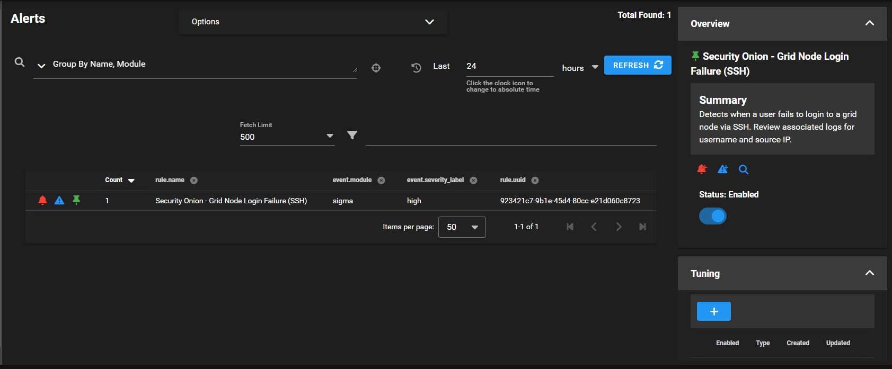
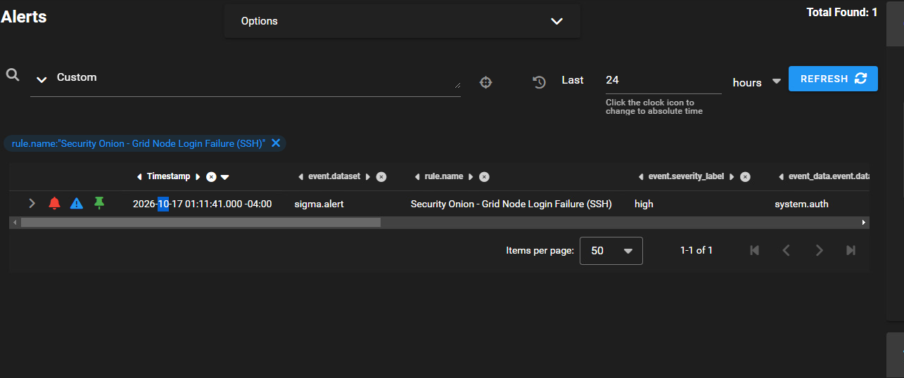
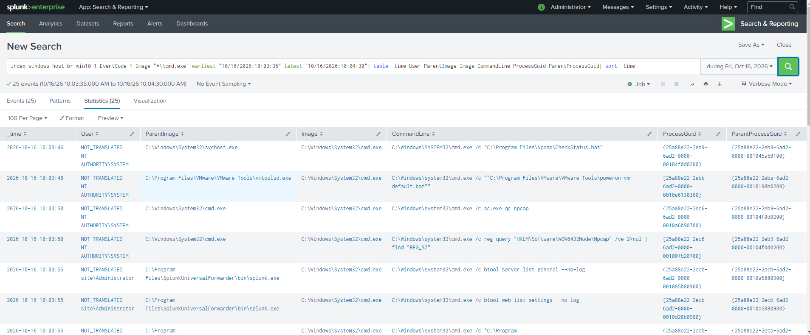
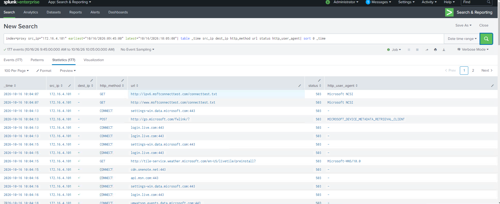
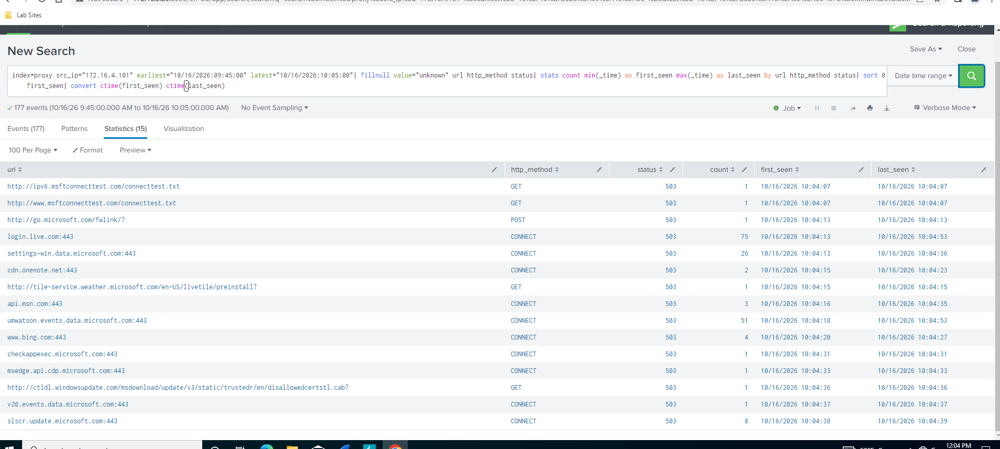
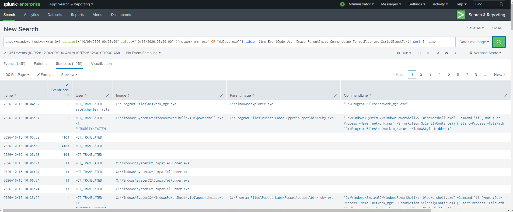

# 6. Background checks and revised leads

[Gallery](README.md) · [Noah / Start here](../README.md) · [Findings](../FINDINGS.md)

## EV-006 — Early Security Onion alert overview

**Look for:** An early alert view shows one SSH-login-failure alert.

**Do not conclude:** It does not show a clean network; the tool was later reported to be malfunctioning.

[Open original image](images/EV-006_securityonion-alerts-24h.png) · [Verify hash](manifest.csv)

---

## EV-007 — SSH alert drilldown

**Look for:** The alert drilldown exposes its timestamp and authentication-related dataset.

**Do not conclude:** No malicious actor or successful access is established; this is not part of the confirmed payload chain.

[Open original image](images/EV-007_so-ssh-login-failure-drilldown.png) · [Verify hash](manifest.csv)

---

## EV-016 — Visible routine startup commands

**Look for:** The visible rows show Npcap, VMware Tools and Splunk-related startup/configuration commands.

**Do not conclude:** Those visible rows are not evidence of initial attacker entry; they also do not exclude every other action in the period.

[Open original image](images/EV-016_brwin10-1_1003-process-parents.png) · [Verify hash](manifest.csv)

---

## EV-020 — Early proxy search, partial display

**Look for:** A 09:45–10:05 proxy query returns 177 matches; the screenshot displays only part of them.

**Do not conclude:** The visible rows do not prove a successful payload download or exclude another route/time.

[Open original image](images/EV-020_brwin10-1_proxy-before-execution.png) · [Verify hash](manifest.csv)

---

## EV-021 — Early proxy search summarized

**Look for:** A grouped summary accounts for 177 matching events with displayed status 503 and Microsoft-related destinations.

**Do not conclude:** This window does not demonstrate delivery; it does not rule out delivery outside that scope.

[Open original image](images/EV-021_brwin10-1_proxy-summary.png) · [Verify hash](manifest.csv)

---

## EV-023 — Puppet maintenance context

**Look for:** The screenshot shows a Puppet-related process checking for and requesting startup of network_mgr.

**Do not conclude:** The user identified Puppet as lab provisioning. Do not count this maintenance loop as attacker persistence or the initial access path.

[Open original image](images/EV-023_brwin10-1_puppet-network-mgr.png) · [Verify hash](manifest.csv)

---

[Previous chapter](05-recovery-and-tool-limits.md)
